 

### Stack

<picture>
  <source media="(prefers-color-scheme: dark)" srcset="https://skillicons.dev/icons?i=java,spring,mysql,aws,ts,react,vite,threejs,supabase,python,qt,git,githubactions,vercel&theme=dark&perline=7"/>
  
</picture>

  

### Repositories

<a href="https://github.com/JSM-02/subway-lostfound">
  <picture>
    <source media="(prefers-color-scheme: dark)" srcset="https://github-readme-stats.vercel.app/api/pin/?username=JSM-02&repo=subway-lostfound&theme=github_dark&hide_border=true&bg_color=00000000"/>
    
  </picture>
</a>
<a href="https://github.com/JSM-02/anyak">
  <picture>
    <source media="(prefers-color-scheme: dark)" srcset="https://github-readme-stats.vercel.app/api/pin/?username=JSM-02&repo=anyak&theme=github_dark&hide_border=true&bg_color=00000000"/>
    
  </picture>
</a>

  

### Activity

<picture>
  <source media="(prefers-color-scheme: dark)" srcset="https://github-readme-activity-graph.vercel.app/graph?username=JSM-02&bg_color=00000000&color=8b949e&line=7ee787&point=e6edf3&area=true&area_color=7ee787&hide_border=true&radius=8"/>
  
</picture>
